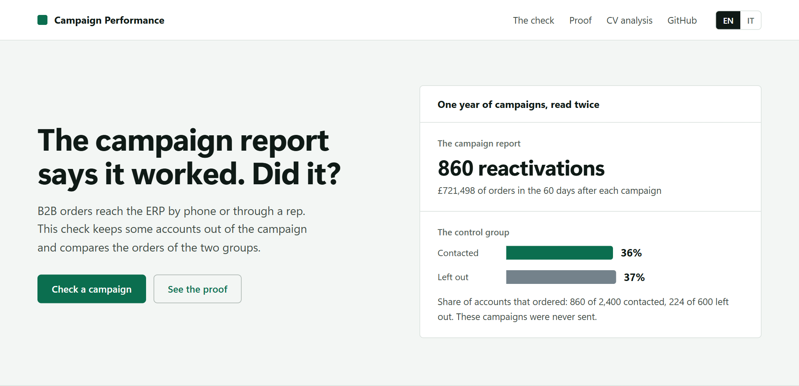

# Digital Campaign Performance Dashboard

**Did the campaign bring orders, or would those customers have ordered anyway?** A control group for B2B campaigns, measured on the orders in the ERP.

**[Open the page](https://errer441122.github.io/digital-campaign-performance-dashboard/)** · [the proof](analysis/campaign_check.md) · [the analysis in my CV](#the-analysis-in-my-cv)

[](https://errer441122.github.io/digital-campaign-performance-dashboard/)

## The problem

In B2B the order comes in by phone, by email or through a sales rep and ends up in the ERP. The email tool knows who was contacted, the ERP knows who ordered, and nobody compares the two with customers who were *not* contacted. So every contacted customer who orders looks like a result of the campaign.

## How it works

Two exports from the ERP (customer, date, amount), one before the campaign and one after it.

| Step | Command | What you get |
| --- | --- | --- |
| **Before** | `python src/campaign_check.py plan --orders orders.csv --campaign "Spring catalogue"` | `contact.csv` for whoever runs the campaign, `left_out.csv` with one customer in five to leave alone, and how big an effect a list of that size can show |
| **After 60 days** | `python src/campaign_check.py measure --plan plan/plan.csv --orders new_orders.csv` | What a campaign report would say, what the control group says, and the verdict: worked, no proof, or too early |

- **The list is yours** (`--list`), for example the customers invited to a trade show. Without one, the tool proposes the customers who are late against *their own* ordering rhythm: silent for more than twice their usual gap, not for a fixed 90 days.
- **The draw is fair.** Customers are sorted from the biggest and taken five at a time; a hash of the campaign name and the customer code picks the one left out. Nobody chooses, and it can be repeated.
- **Key accounts** can be always contacted and never counted (`--key-accounts 10`).
- **No peeking.** Before the window ends, the tool refuses to answer.

It reads what ERPs write: semicolons, decimal commas, `31/12/2026`, SAP's trailing minus, Italian or English headers, credit notes as negative amounts. The same code runs [in the browser](https://errer441122.github.io/digital-campaign-performance-dashboard/#check), where the files never leave the computer.

## The proof: six campaigns that never happened

The public data of a real wholesaler has 36,969 orders and no campaigns. I invented six, 60 days each, drew the groups and sent nothing. The right answer is known: no effect.

| | Contacted | Ordered within 60 days | Share |
| --- | ---: | ---: | ---: |
| "Contacted" (nothing was sent) | 2,400 | 860, for £721,498 | 36% |
| Left out | 600 | 224 | 37% |

- **A campaign report would have claimed 860 reactivations.** More than one late customer in three comes back alone.
- **The check is rarely fooled:** of 1,800 made-up campaigns it called 2.1% "worked".
- **It is honest about small lists:** with one customer in five left out, it sees an effect of 20 points 9 times out of 10, one of 10 points less than half the time.

Every number is rebuilt by [`src/backtest.py`](src/backtest.py) in CI: [full tables](analysis/campaign_check.md).

## What other software already does

| Tool | What it does | What stays open in B2B |
| --- | --- | --- |
| Email platform | Opens, clicks, online orders. Klaviyo has [control groups](https://help.klaviyo.com/hc/en-us/articles/18138290642971), for accounts with at least 400,000 profiles | Offline orders are there only if someone connects the ERP, and B2B lists rarely reach that size |
| CRM | Who was contacted, and the deals people remember to update | Invoices are usually in the ERP |
| ERP | Every order | Not who was contacted, and nobody to compare them with |
| Sales analytics for distributors | Alerts on customers who spend less, e.g. [sales-i](https://support.sugarai.com/documentation/sales-i/user_guide/alerts). Better than this list if you own it | Whom to call. Whether the call changed anything still needs a group that was not called |

## What is real and what is not

| Real | Not yet |
| --- | --- |
| The orders: a UK company, many of whose customers are wholesalers (UCI, 2009 to 2011) | The campaigns: invented, so that the right answer is known |
| The rules, the draw and the verdict, tested on files written by hand | A campaign of a real company. That is the next step |

Limits: it counts customers who ordered, because one large order moves a revenue total; it fails if the left-out customers are contacted anyway; a small effect on a short list stays invisible, and the plan says so in advance.

## The analysis in my CV

| What my CV says | Where it is |
| --- | --- |
| RFM, cohort retention and customer value on 5,878 real customers; Champions are 26% of customers and 71% of revenue | [Live analysis](https://errer441122.github.io/digital-campaign-performance-dashboard/analysis.html), [tables](analysis/crm_retention.md), [Excel](dashboard/crm_dashboard.xlsx). Customer value is what each customer has spent so far, by country, not a forecast |
| Markov attribution, budget reallocation, GA4 event plan, UTM taxonomy, lead scoring | [Version of October 2026](https://github.com/errer441122/digital-campaign-performance-dashboard/tree/october-2026). It ran on campaign data I had simulated. I removed it in November 2026: numbers I invent cannot show how a campaign performs |
| Python, SQL | [`src/`](src), and the [notebook](notebooks/cross_check.ipynb) that recalculates the main numbers with pandas and DuckDB SQL |

The report builder that stood here in November 2026 is gone too: RFM reports on online orders are already in Klaviyo and Shopify. It is kept under the tag [`rfm-dashboard`](https://github.com/errer441122/digital-campaign-performance-dashboard/tree/rfm-dashboard).

## Run it

```bash
python src/campaign_check.py plan --orders data/online_retail_orders.csv --campaign demo --as-of 2011-05-30
python src/campaign_check.py measure --plan plan/plan.csv --orders data/online_retail_orders.csv
python -m pip install -r requirements.txt && python -m pytest -q
```

The check needs only Python. The requirements are for the tests and the Excel and chart of the analysis.

| Path | Content |
| --- | --- |
| `src/campaign_check.py` | The draw, the count and the verdict |
| `src/erp_export.py` | Reading ERP and Excel files |
| `src/backtest.py` | The six campaigns that never happened |
| `src/crm_retention.py`, `src/crm_lifecycle.py` | The analysis in my CV |
| `docs/` | The page and the analysis page (GitHub Pages) |
| `tests/` | 51 checks, run on every change |

## Data

Chen, D. (2019). *Online Retail II*. UCI Machine Learning Repository, CC BY 4.0. Source and cleaning rules: [`data/REAL_DATA_PROVENANCE.md`](data/REAL_DATA_PROVENANCE.md). The company may have run its own marketing in those years; it reached both groups alike.

## How I built this

I am a Digital Marketing student, not a developer. The code was written with AI coding assistants. My part was choosing the question, the rules and the data, checking the results and deciding what to report. MIT licence.
