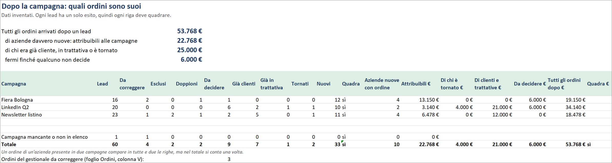

# Digital Campaign Performance Dashboard

Il nome è quello del link stampato sul mio CV; l'analisi citata lì è [più sotto](#lanalisi-del-mio-cv). · Repo name kept so the link on my CV still works.

> **English summary (full README in Italian below):**
> - **Problem:** At quarter end, marketing counts campaign leads, sales tracks deals and finance counts ERP orders — none of the three systems agree on which orders came from campaigns.
> - **How it works:** A macro-free, AI-free Excel workbook reconciles three exports (campaign leads, CRM contacts, ERP orders) with 8 fixed rules (VAT/domain matching, cancelled orders, credit notes, existing vs. new accounts, 180-day window) and sends ambiguous cases to a named owner.
> - **Verification & limits:** Simulated dataset of 60 dirty edge cases verified across 368 automated Excel checks (no live company deployment yet); also includes the public UCI retail RFM analysis referenced in my CV (`analisi-cv/`).

**Problema.** Riunione di fine trimestre: il marketing conta 60 lead, il commerciale le trattative, l'amministrazione gli ordini. Nessuno dei tre programmi sa quali ordini vengono dalle campagne.

**Entra.** Tre export: lead delle campagne, contatti del CRM, ordini del gestionale.

**Succede.** Otto regole fisse in un foglio Excel, una colonna per regola. Nessuna macro, nessuna AI: ogni domanda ha una sola risposta giusta, oppure la decide una persona.

**Esce.** Una tabella che quadra, la lista per i commerciali e i casi da decidere con il nome di chi decide.

**[Scarica il foglio](campagna-ordini.xlsx?raw=true)** · [Provalo in 90 secondi](#provalo-in-90-secondi) · [Le regole](#le-otto-regole) · [Pagina](https://errer441122.github.io/digital-campaign-performance-dashboard/) · [L'analisi del mio CV](#lanalisi-del-mio-cv)

> **Dati inventati**, con 60 casi sporchi messi apposta. Nessuna azienda lo ha ancora usato. Qui si misura se i casi vengono gestiti come previsto, non un risultato economico.

## Cosa esce

| Foglio | A chi va | Righe |
| --- | --- | ---: |
| *Riepilogo* | Marketing, commerciale e amministrazione, la stessa tabella | 3 campagne |
| *Per i commerciali* | Chi contattare, chi lo segue già, perché. Solo chi ha detto sì e mai no | 39 |
| *Da decidere* | Domanda precisa, ordini in gioco, chi decide | 13 |
| *Ordini*, colonna V | All'amministrazione: gli ordini che non si leggono | 3 |

## Provalo in 90 secondi

Apri una copia in Excel.

1. Foglio *Lead*, cella **I7**, consenso di Aldo Corsi: scrivi `revocato`. La lista *Per i commerciali* scende da 39 a 38; nel *Riepilogo* Aldo resta tra i nuovi.
2. Foglio *Ordini*, cella **F6**, ordine 7001: scrivi `Annullato`. Gli attribuibili scendono da 22.768 a 14.768 euro.
3. Foglio *Regole*, cella **B4**: 210 al posto di 180. Entrano due ordini arrivati tardi e gli attribuibili salgono a 28.745 euro (con l'ordine 7001 rimesso a `Ordine`).

## Le otto regole

| Regola | Cosa succede | Perché |
| --- | --- | --- |
| **R1 Riga leggibile** | Servono data, campagna e almeno un'email o una partita IVA valida. Altrimenti *Da correggere* | Una data impossibile non si indovina |
| **R2 Interni e prove** | Fuori dal conto | Gonfiano i lead |
| **R3 Stessa persona** | Nella stessa campagna conta la prima riga | Un modulo compilato due volte non sono due lead |
| **R4 Stessa azienda** | Partita IVA valida, o dominio collegato a una partita IVA nel CRM o negli ordini. Nome uguale, gmail, o dominio con più partite IVA: *Da decidere* | Un omonimo non è un cliente |
| **R5 Ordine valido** | Conta una volta, se data e importo si leggono. Annullato vale zero. La nota di credito si toglie dall'ordine a cui si riferisce, anche se arriva dopo | [Nei dati veri](prove/README.md) i due ordini più grandi dell'archivio erano annullati lo stesso giorno |
| **R6 Cosa c'era prima** | Ordini prima del lead: *Già cliente*. Fermo da più di 180 giorni: *Tornato*. Trattativa aperta prima: *Già in trattativa*. Niente: *Nuovo* | [Nei dati veri](prove/README.md) tra il 22 e il 30% dei clienti fermi torna senza nessuna campagna |
| **R7 Attribuzione** | Solo ordini di aziende nuove, nei 180 giorni dopo il lead. Stesso giorno, due campagne, CRM e gestionale in conflitto, due proprietari: *Da decidere* | Due campagne non possono prendersi lo stesso ordine |
| **R8 Contatto** | Va ai commerciali solo chi ha detto sì e non ha detto no in nessun file. Chi ha un proprietario resta a lui | Un sì nel modulo non cancella un no nel CRM |

Numeri e parole (giorni, domini, come si scrive "sì", nomi delle fasi) si cambiano nel foglio *Regole*.

## Cosa non fa mai

- Non scrive nel CRM o nel gestionale: si incollano tre export, il risultato sta in colonne diverse.
- Non tocca la fonte originale né il proprietario che sono nel CRM: li riporta.
- Non attribuisce a una campagna l'ordine di chi comprava già.
- Non unisce due aziende per il nome e non interpreta un importo ambiguo come `1200.50`.
- Non manda ai commerciali chi ha detto no, neanche se l'ha detto in un altro file.

## Casi sporchi: 60 su 60

[`casi-attesi.csv`](casi-attesi.csv) elenca ogni caso con l'esito previsto. [`verifica-excel.ps1`](verifica-excel.ps1) apre il foglio in Excel, confronta, cambia dati e regole in memoria, rimette le righe al contrario, svuota un file intero: **368 controlli superati, 0 falliti** (Excel 16 per Windows, 25 novembre 2026). Ad ogni modifica GitHub ricontrolla i 60 esiti salvati nel foglio.

Tre errori veri che i casi hanno trovato nelle prime versioni:

- un cliente di vecchia data presente in due campagne finiva tra i casi da decidere;
- un "no" scritto nella seconda riga della stessa persona non la fermava;
- un ordine conteso tra due campagne era sommato due volte nel totale.

## Dove si ferma

- 300 lead, 500 contatti CRM, 1.000 ordini. Oltre, o se i file cambiano ogni giorno, serve un'integrazione tra CRM e gestionale.
- Una persona alla volta: due copie del foglio sono due verità.
- Dice che un'azienda era nuova e ha ordinato dopo. Non dimostra che abbia ordinato *grazie* alla campagna: per quello servirebbe un gruppo non contattato.
- Una sola valuta, importi senza IVA. Un lead senza azienda riconoscibile resta da decidere.
- Se il CRM riceve già gli ordini dal gestionale, il foglio serve solo per i casi che l'integrazione lascia aperti.

## Le stesse regole altrove

| | HubSpot | Salesforce | Power BI o un altro CRM |
| --- | --- | --- | --- |
| R4 Azienda | Associazione azienda, dominio, proprietà P.IVA | Account e P.IVA | Chiave P.IVA, poi dominio |
| R5-R6 Ordini | Dal gestionale: integrazione o file | Idem | Tabella ordini collegata alla stessa chiave |
| R7 Da decidere | Elenco con una proprietà "esito" e un'attività per chi decide | Campo esito e attività | Filtro sulle righe senza esito |
| R8 Contatto | Consenso del contatto, proprietario | Consenso e owner del lead | Colonne consenso e proprietario |

## L'analisi del mio CV

| Cosa dice il CV | Dove si trova |
| --- | --- |
| RFM, coorti e CLV su 5.878 clienti veri; i Champions sono il 26% e fanno il 71% del fatturato | [Pagina](https://errer441122.github.io/digital-campaign-performance-dashboard/analysis.html), [tabelle](analisi-cv/analysis/crm_retention.md), [Excel](analisi-cv/dashboard/crm_dashboard.xlsx). Il CLV è quanto un cliente ha speso finora, per Paese, non una previsione. L'analisi contava anche 275 ordini annullati lo stesso giorno: senza, le due quote sono [26,1% e 71,5%](prove/README.md) |
| Attribuzione con Markov, budget, piano GA4, UTM, lead scoring | [Versione di ottobre 2026](https://github.com/errer441122/digital-campaign-performance-dashboard/tree/october-2026). Girava su campagne simulate da me: l'ho tolta, perché numeri inventati non dimostrano come va una campagna |
| Python e SQL | [`analisi-cv/src`](analisi-cv/src) e il [notebook](analisi-cv/notebooks/cross_check.ipynb) che ricalcola i numeri con pandas e DuckDB |

## Come è fatto

Studente di Digital Marketing, non sviluppatore. Foglio, collaudo e codice sono stati costruiti con assistenti AI. Licenza MIT; dati UCI *Online Retail II* CC BY 4.0.
